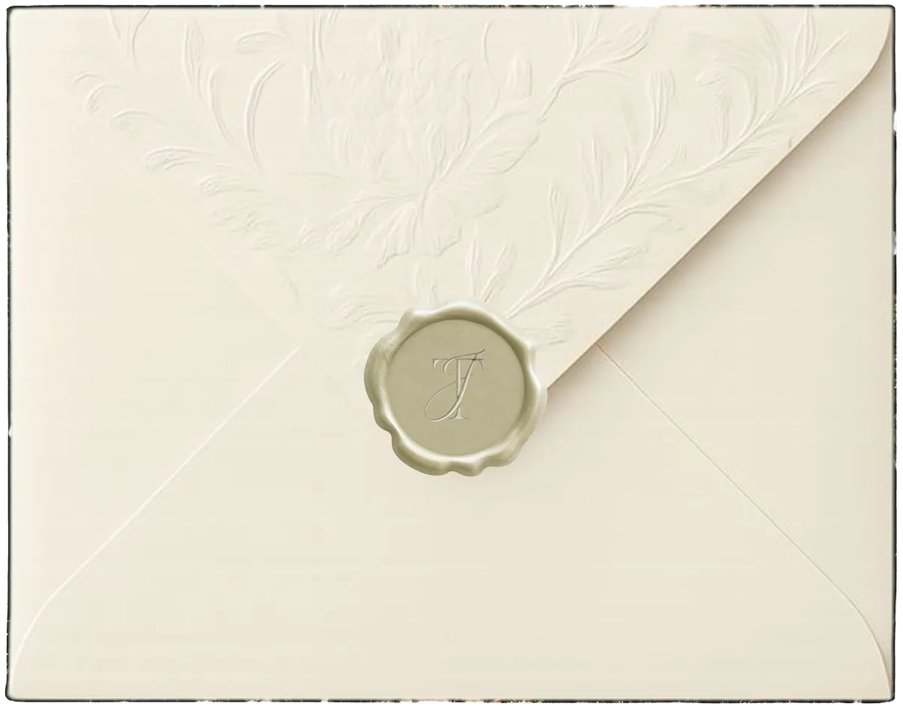

# Thành & Trinh — Wedding Invitation

A mobile-first, scroll-driven invitation built from the original design files.
No framework, no build step: open `index.html` and it runs.

```
index.html
css/app.css          layout system + scene shell
css/scenes.css       interactive components (scratch, vinyl, countdown, RSVP, QR)
js/config.js         ← the only file you need to edit
js/app.js            runtime
assets/img/*.webp    backgrounds + cut-out layers
assets/video/        the page-6 film
assets/audio/        drop the music here
apps-script/Code.gs  the RSVP endpoint
```

## How a guest moves through it

Pages **1–8 are a deck, not a scroll**: eight full-screen pages stacked on top of each
other, only one visible, cross-fading between them.

| input | result |
|---|---|
| tap / click anywhere | next page |
| swipe up / down | next / previous |
| ← ↑ → ↓ space | previous / next |
| page 2 | will not turn until the silver panel is scratched (gives way after 3 tries) — once ~38 % is off, the rest of the foil is swept away in one wave and the whole card shows |
| page 6 | plays the film **with its own sound**, then turns **itself** when it finishes — no tap needed |
| page 8 → tap | the deck lifts and H1 takes over as a normal scrolling page |
| foot of H1 | a menu surfaces — **Tap to see details** — and only that opens H2 |

### The motion

Each page plays its entrance when it is tapped into view. The vocabulary was read
frame-by-frame off `Save the Date_Motion reference.mp4` (54.5 s, 4:9, the same aspect as
the artwork), and the designer's three moves are:

| token | what it does | where the reference uses it |
|---|---|---|
| `unfoldX` | `scaleX(.045) → 1` anchored to the **left edge** | the envelope on p1, the card on p2, the hero frame on p7 |
| `unfoldY` | `scaleY(.05) → 1` anchored to the **top edge** | the opened envelope on p5 unfolds downward from its flap |
| `wipe` | `clip-path` reveal **left → right** | all script lettering, the three bands of p6, the paragraphs on p7/p8 |

Plus two one-offs: a **white wash** on the single turn from page 1 to page 2 (the reference
flares the whole frame white there), and page 8 arriving as one sheet wiping in **from the
right** (`data-enter="wipeR"` on the section).

Timing lives in the markup as `--d` (delay) per layer, so re-choreographing a page means
editing numbers, not CSS.

While the deck is running the document cannot scroll (`html.deck-on { overflow:hidden }`).
Once it is done, `html.deck-done` fades the deck out, scrolling is released and H1/H2
behave as a normal long page. A hairline at the top fills as the guest advances.

Without JavaScript the deck is hidden entirely and the guest gets the written
invitation (H1 + H2) straight away.

## The coordinate system

Every layer is positioned in the **original design pixel space** — 6047 × 13606 for the
cinematic scenes, 2732 × N for the two long sections. One CSS variable converts a design
pixel into a CSS pixel:

```css
--u: calc(var(--colw) / 6047);     /* scenes */
--u: calc(var(--colw) / 2732);     /* H1 / H2 */
```

so a layer is written with the exact numbers measured off the artwork:

```html

```

Nothing is hard-coded to a breakpoint, nothing is re-measured per device, and the whole
invitation scales as one piece. To nudge an element, change its `--x` / `--y`.

`--colw` is `min(100vw, 100svh × 4/9)`, so the 4:9 artwork always fits the screen whole —
never cropped on a phone, framed like a phone on a desktop.

---

## 1 · The music — already in place

`assets/audio/the-ordinary.mp3` holds your track (3:07). It was re-encoded from the
4.4 MB original to 3.0 MB at 128 kbps, with a 1.2 s fade-in and a 2.6 s fade-out so the
loop seam is silence-to-silence instead of a hard cut.

To swap it, drop a new file at that same path, or point `js/config.js` elsewhere:

```js
MUSIC_SRC: 'https://your-cdn.example.com/the-ordinary.mp3',
```

The track fades in automatically when a guest reaches page 7, and the vinyl record is a
play/pause button. It keeps playing past the deck, so a small matching control
(`#mini-music`) sits in the bottom-right corner of the scrolling pages — otherwise the
guest would have no way to silence it once the vinyl is gone. If the file cannot be
loaded at all, that control hides itself rather than offering a dead button. Browsers block autoplay until the visitor has interacted — the scratch
on page 2 counts, so by page 7 playback is allowed. If a browser still refuses, the record
pulses with a ring until it is tapped.

## 2 · Wire up the RSVP

1. Create a Google Sheet.
2. **Extensions ▸ Apps Script**, delete the placeholder, paste **`apps-script/Code.gs`**.
3. **Deploy ▸ New deployment ▸ Web app** — *Execute as:* **Me**, *Who has access:* **Anyone**.
4. Copy the `…/exec` URL into `js/config.js`:

```js
RSVP_ENDPOINT: 'https://script.google.com/macros/s/AKfy…/exec',
```

Responses land in a sheet called `RSVP`: timestamp, name, attending, guests, wishes.
Left empty, the form still validates and thanks the guest but stores nothing.

The request is sent as `text/plain` on purpose — that keeps it a CORS "simple request",
which is the only kind an Apps Script web app can answer without a preflight.

## 3 · The rest of `js/config.js`

| key | meaning |
|---|---|
| `EVENT_ISO` | what the countdown counts down to |
| `MAPS_URL` | where the map card opens |
| `SCRATCH_THRESHOLD` | share of the silver panel that must be removed (0–1) |
| `MUSIC_VOLUME` | 0–1 |

---

## Deploying

It is a static site — any host works:

```bash
npx vercel deploy --prod
```

```bash
netlify deploy --prod --dir .
```

For GitHub Pages, push the folder and enable Pages on the branch root.
Serve it over **https**, otherwise some browsers block audio autoplay.

## The page-6 film

`assets/video/page6.mp4` is `Video page 6_new.mov` re-encoded to H.264 1280×720 with its
AAC stereo soundtrack kept (6.5 MB, 30.6 s). It is **not muted**. `play()` is called inside
the very tap that turns to page 6, because Safari only grants sound to a play() that sits in
the user-gesture stack — a delayed play() would come out silent. If a browser still refuses
sound, the film plays muted rather than not at all.

While the film is on screen the background music is hushed, and it comes back when the
guest moves on, so the two soundtracks never play over each other.

## What was changed from the source artwork

- **A submit button was designed and added.** The RSVP card in the source files had fields
  but no way to send them. The new control is a maroon pill pressed onto the bottom edge of
  the card, matching the invitation's ink colour and the wax-seal motif.
- **The printed placeholders were removed** from the RSVP card image (`enter your name`,
  `Share your wishes…`, `2 guets`) and replaced with live form fields, so typed text never
  collides with printed text. The guest-count option is spelled **“2 guests”** — the source
  artwork reads “2 guets”.
- **The countdown numerals were painted out** of the card image and are rendered live, pinned
  to the centre of each printed label.
- Everything else is the original artwork, composited at its measured position.

## Accessibility

Every layer carries the text it depicts as `alt`, the scratch panel and the letter are real
buttons, the QR dialog traps focus and closes on `Esc`, and `prefers-reduced-motion`
disables the drifting butterflies, the spinning record and all entrance motion.
